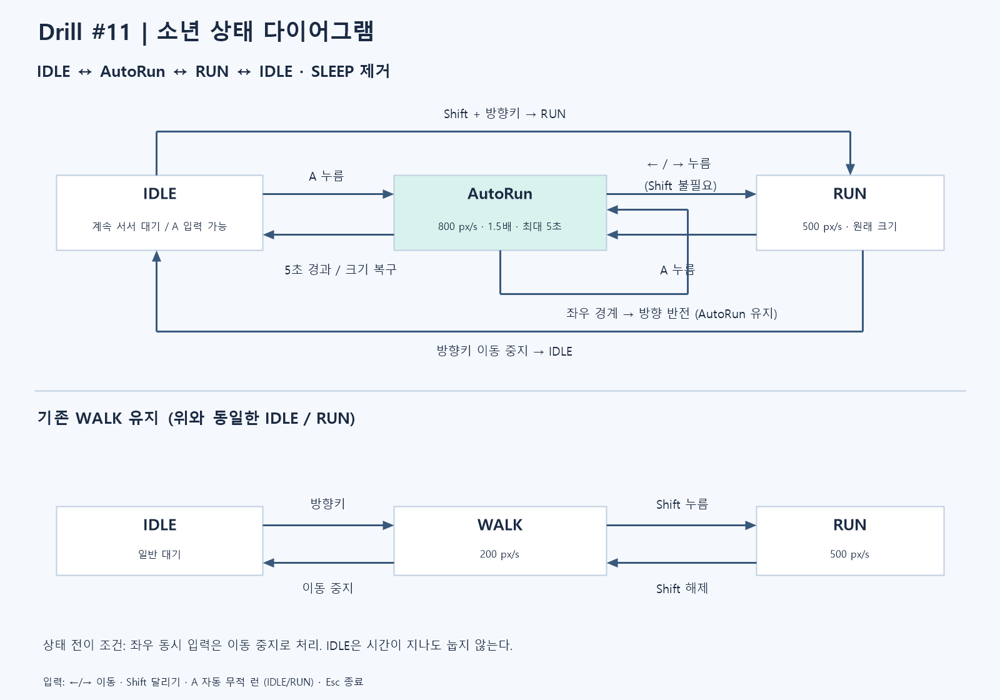

# Drill #11 — 소년 AutoRun 상태 추가

Idle 또는 Run에서 A를 누르면 5초간 빠르고 커진 소년이 자동으로 이동한다.
화면 양끝에서 방향을 바꾸며, 방향키를 누르면 해당 방향의 Run으로 전환한다.



## 실행
Python 3.13과 pico2d 1.5.1을 사용한다. 기본 `python`은 다른 버전을 가리킬 수 있다.
현재 PC에는 Python 3.13에 pico2d가 설치되어 있으므로 추가 설치 없이 다음을 사용한다.

```powershell
.\run.ps1
```

PowerShell 실행 정책으로 스크립트 실행이 막히면 같은 인터프리터를 직접 호출한다.

```powershell
& "$env:LOCALAPPDATA\Programs\Python\Python313\python.exe" .\boy_game.py
```

새 PC에서만, 사용할 인터프리터를 지정해 의존성을 설치한다.

```powershell
& "$env:LOCALAPPDATA\Programs\Python\Python313\python.exe" -m pip install -r requirements.txt
```

다른 위치의 Python 3.13을 사용하면 `run.ps1 -PythonPath '실제 python.exe 경로'`로 지정한다.

### VS Code 연결
현재 PC의 상위 프로젝트, 바깥 drill-11 폴더, 실제 저장소 폴더에 로컬 `.vscode` 설정을 추가했다.
기본 인터프리터, Code Runner, 새 터미널 PATH는 Python 3.13을 사용한다.
F5 또는 Ctrl+F5에서는 **Drill 11: Python 3.13 (pico2d)** 구성을 선택한다.
이 구성은 디버거의 Python 경로도 직접 지정하므로 기존 인터프리터 선택 캐시와 무관하다.
기존 터미널은 닫고 새로 연다. 필요하면 `Developer: Reload Window`로 창을 다시 로드한다.
Python 확장의 Run Python File이 이전 선택을 계속 쓰면 `Python: Select Interpreter`에서
`%LOCALAPPDATA%\Programs\Python\Python313\python.exe`를 한 번 선택한다.
VS Code는 기존 선택이 있으면 defaultInterpreterPath 변경만으로 그 선택을 바꾸지 않을 수 있다.
`.vscode`는 PC별 절대 경로를 담아 Git에서 제외한다. 새 PC에서는 해당 PC의 인터프리터를 선택한다.

이 저장소 폴더에서 실행한다. 이미지 경로는 파일 위치 기준이므로
다른 작업 폴더에서도 boy_game.py의 전체 경로로 실행할 수 있다.
상태 클래스는 직접 연결하므로 기존 실습의 transitions 패키지는 필요하지 않다.

## 조작
| 입력 | 동작 |
|---|---|
| ← / → | Walk, Shift를 함께 누르면 Run |
| A (Idle / Run에서) | AutoRun: 800 px/s, 1.5배, 최대 5초 |
| ← / → (AutoRun에서) | 자동 이동 취소, 누른 방향 Run. Shift 불필요 |
| Esc / 창 닫기 | 종료 |

AutoRun은 마지막으로 바라보던 방향으로 출발한다. A를 다시 눌러도
진행 중인 AutoRun의 5초 타이머는 연장되지 않는다.
AutoRun에서 다른 상태로 나갈 때 크기는 1배로 돌아온다.
일반 이동에서 좌우를 함께 누르면 정지한다.
IDLE은 시간이 지나도 서서 대기하며 A 입력을 계속 받는다. SLEEP 상태는 제거했다.
IDLE → RUN은 Shift + 방향키, RUN → IDLE은 이동키 해제,
RUN → AutoRun은 A, AutoRun → RUN은 방향키,
IDLE → AutoRun은 A, AutoRun → IDLE은 5초 경과로 연결한다.

## 파일 구조
```text
boy_game.py              실행 루프, 입력 전달, 그리기 순서
boy.py                   캐릭터 데이터와 상태 연결
input_state.py           방향키 및 Shift 입력 추적
renderer.py              이미지 로딩과 캐릭터 표시
config.py                속도, 배율, 시간, 화면 크기
grass.py                 지면 표시
states/base.py           상태 진입/종료/입력/갱신 인터페이스
states/idle.py           Idle 대기와 A 입력
states/walk.py           Walk
states/run.py            Run
states/auto_run.py       독립 AutoRun 클래스
assets/                  이전 실습에서 복사한 이미지 3개
docs/state-diagram.png   제출용 상태 다이어그램 이미지
docs/state-diagram.mmd   전체 상태 전이 원본
PRE-PRD.md               사전 분석과 단계별 개발 계획
PRD.md                   요구사항, 실행 및 수용 기준
docs/USER-CHECKS.md      사용자가 직접 수행할 실행 확인표
```

## 제출
1. [사용자 확인표](docs/USER-CHECKS.md)에 따라 실행한다.
2. 사용자가 이 독립 저장소를 Public으로 publish/push한다.
3. GitHub에서 PRD.md, Python 코드, assets의 이미지 3개,
   docs/state-diagram.png, 실제 개발 커밋 20개 이상을 확인한다.
4. Discord 공지의 AI 사용 과제 제출 요령, 수업 시간과 마감 시각을 확인한다.
5. 안내된 자료와 저장소 링크를 e-Class에 제출하고 제출 결과를 확인한다.

코드 작성에는 Codex를 사용했다. 실행 및 동작 확인은 사용자 담당이다.
이 문서는 로컬 작성 기록이며 원격 업로드나 e-Class 제출 완료를 뜻하지 않는다.

## 리소스 출처
assets/animation_sheet.png, assets/run_animation.png, assets/grass.png는
이전 LEC12_CharacterController 실습에서 원본 바이트를 복사했다.
과제 리소스의 외부 사용·배포 허용 범위는 별도로 확인해야 한다.
